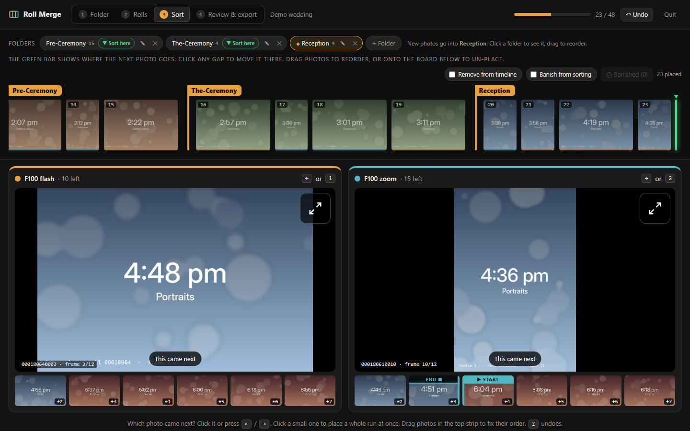
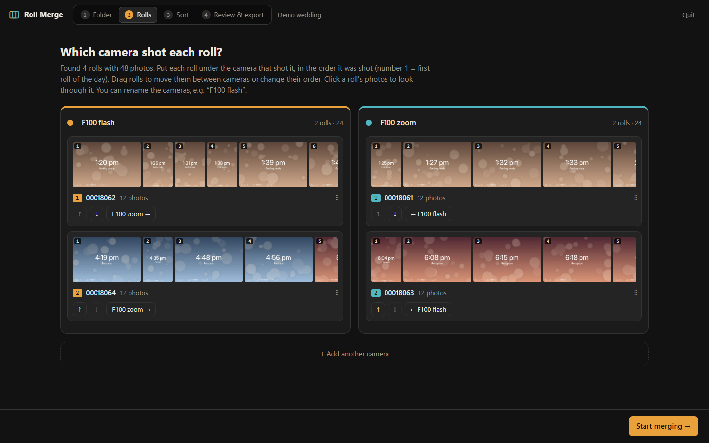
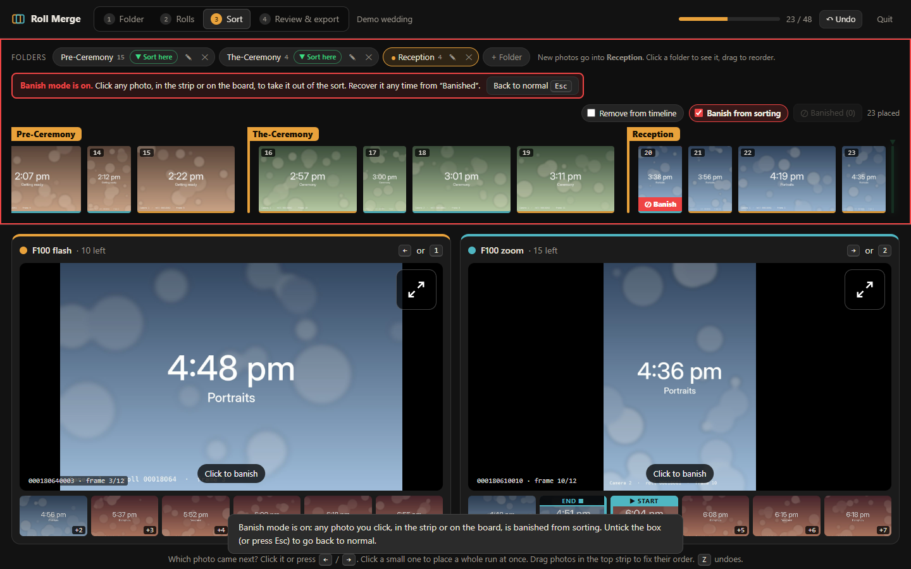
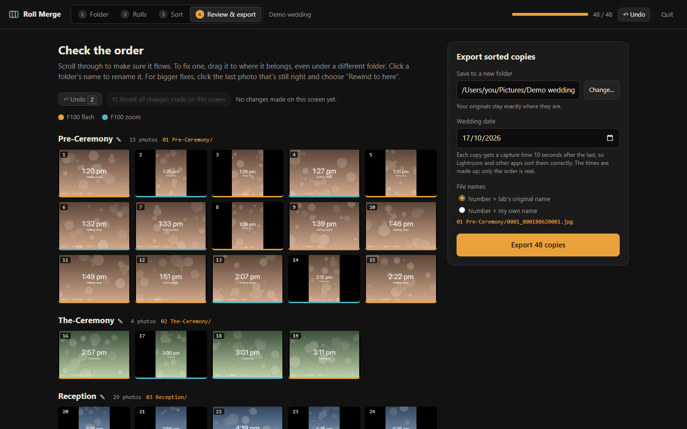

# Roll Merge

**Puts film scans from two (or more) cameras back into the order they were shot, or sorts one big
folder of photos into folders.**

Shooting a wedding on two film cameras? The lab sends the scans back one folder per roll. Each
roll is in order, but nothing says how the two cameras' rolls fit together. Roll Merge shows the
next photo from each camera side by side, you click whichever one came next, and at the end it
saves **numbered copies** in a new folder, optionally split into folders like *Pre-Ceremony*,
*The-Ceremony* and *Reception*.

**Your original files are never changed.** Everything runs on your own computer; nothing is
uploaded anywhere.

## Download

Get **`Roll Merge.zip`** from the [latest release](https://github.com/0x-ccsol/Roll-Merge/releases/latest)
and unzip it. Works on **Mac** and **Windows**.

## First time only

1. **Install Python 3** if the computer doesn't have it: <https://www.python.org/downloads/>
   (Windows: tick **"Add python.exe to PATH"** in the installer.)
2. **Mac only:** the first time, macOS may say the Start file "can't be opened".
   Right-click **Start Roll Merge (Mac).command** and choose **Open**, then **Open** again.
   On newer macOS: **System Settings → Privacy & Security** → scroll down → **Open Anyway**.
3. The first start installs a couple of small parts (needs internet, about a minute).

## How to use it

### 1. Start it and choose the folder

Double-click **Start Roll Merge (Mac).command** (or the Windows one). A small window opens and
the app opens in your web browser. Keep that small window open while you work. Then choose the
folder the lab sent (the one with a folder for each roll).

### 2. Tell it which camera shot each roll

Put each roll under the camera that shot it, in shooting order. Drag rolls between cameras or
use the arrow buttons. Scroll along a roll's photos with the mouse wheel (or the bar under
them), and click one to see it large if you're not sure.

### 3. Click whichever photo came next

- **← / →** (or **1**, **2**) pick camera 1 / camera 2.
- Click a small photo further along to place a **whole run at once**.
- **Z** undoes. Your progress **saves by itself**, so you can quit and carry on later.
- **Folders:** click **+ Pre-Ceremony · The-Ceremony · Reception**, then **▼ Sort here** on a
  folder to start filling it.
- The **mouse wheel** scrolls the strip of placed photos at the top. Drag photos in it to fix
  their order.
- **Remove from timeline:** tick it, then click photos in the top strip to send them back down
  to be placed again. Untick it (or press **Esc**) afterwards.
- **Banish from sorting:** tick it, then click bad frames or exact duplicates to leave them out.
  Nothing is deleted: **Banished** lets you get them back.

### 4. Review, then export

Check the full timeline. You can still drag photos to fix their order and click a folder's name
to rename it. **Undo**, or **Revert all changes made on this screen**, fixes mistakes.

Then **Export**. The copies are numbered (0001, 0002 …) and get capture times in order, so
Lightroom and other apps sort them correctly. To be safe, sort by **File Name**.

## Sort a shoot into folders

Got one folder with a whole shoot in it, say jewellery photos that need splitting into
*Bracelets*, *Necklaces* and *Earrings*? Choose **Roll Sort** on the first screen, then choose
the folder. For film rolls, choose **Roll Merge**. It remembers your choice; click the name at the
top left to switch. The two are kept completely separate, each with its own progress and settings.

- Add a folder for each group with **+ Folder**.
- **Click** a photo to put it in the current folder; **▼ Sort here** switches folder.
- To do many at once, **Shift-click** the first photo, then **Shift-click** the last: everything in
  between is selected. Press **Enter** to put them in the current folder.
- **Space** shows the photo under the mouse large; click outside the photo to close it.
- Sorted photos leave a **blank space**, so nothing shifts while you click quickly. Press **R** (or
  **Refresh board**) to close up the gaps; it also does it by itself after 12 gaps once you pause.
- Export makes a copy in each folder, keeping the **original names** (or naming them
  *Bracelets 001*, *Bracelets 002* …) and each photo's **own date**.

## Try it first

The **Demo wedding** folder has 4 short practice rolls from 2 cameras. Each demo photo shows the
time it was "taken", so you can check the result. Camera 1 shot the rolls ending **2** and
**4**; camera 2 shot **1** and **3**.

For **Roll Sort**, the **Fruit demo** folder has 30 mixed-up photos of apples, oranges and bananas.
Add folders such as *Apples*, *Oranges* and *Bananas* and sort them; each photo is labelled, so
you can check the result.

## Good to know

- Works with **JPG** and **TIFF**.
- Thumbnails are cached so reopening is quick. The cache cleans itself up.
- Quit with the **Quit** button in the app, or by closing the small window.
- Needs Python 3.8 or newer. The two extra parts it uses
  ([Pillow](https://python-pillow.org/) and [piexif](https://pypi.org/project/piexif/)) are
  installed automatically on the first start, into a private folder next to the app.
