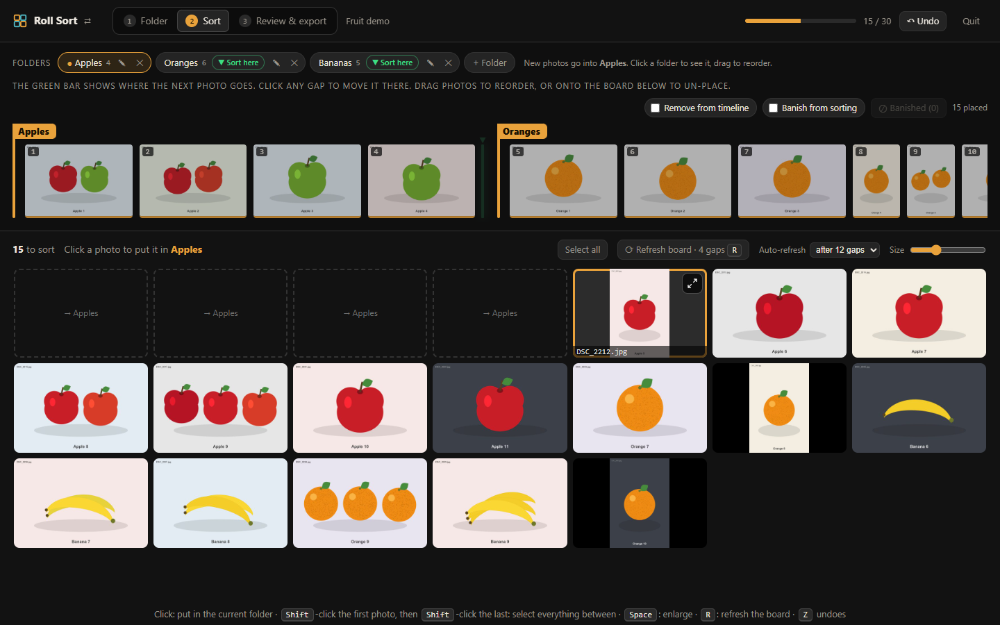
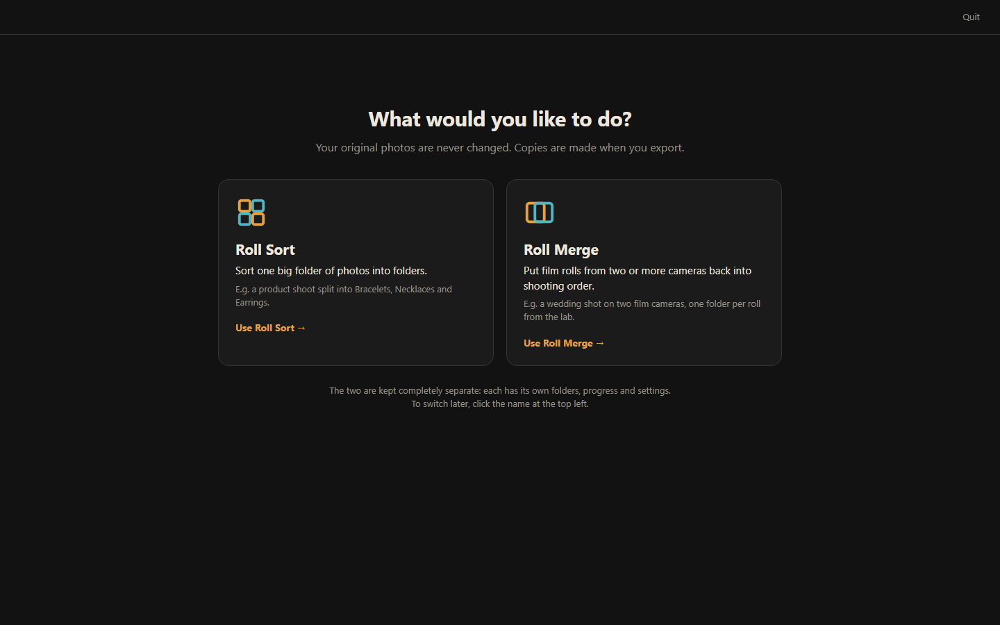
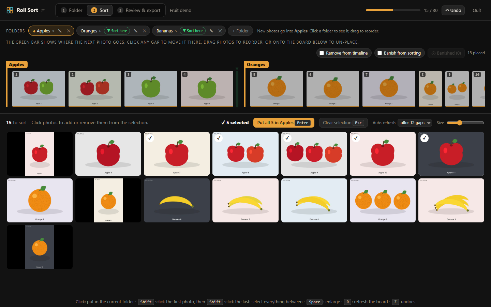
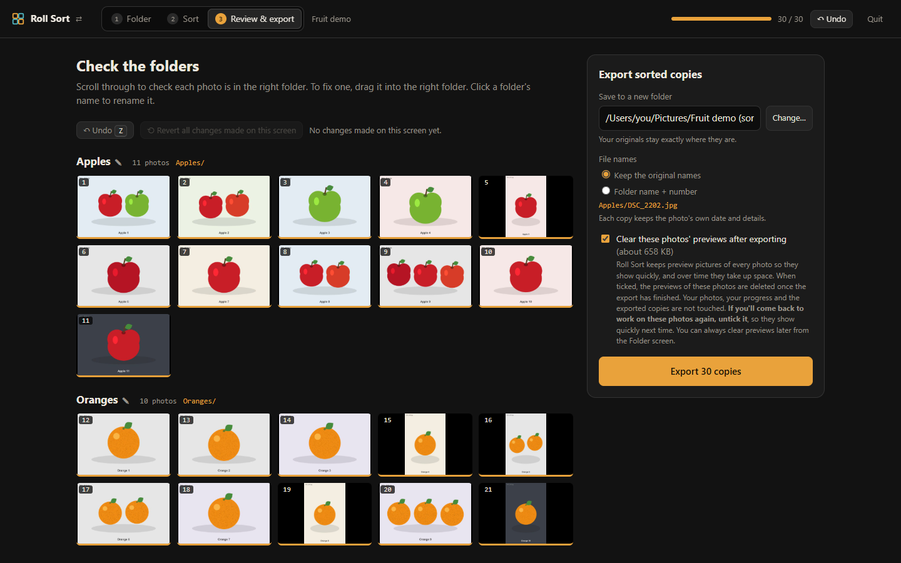
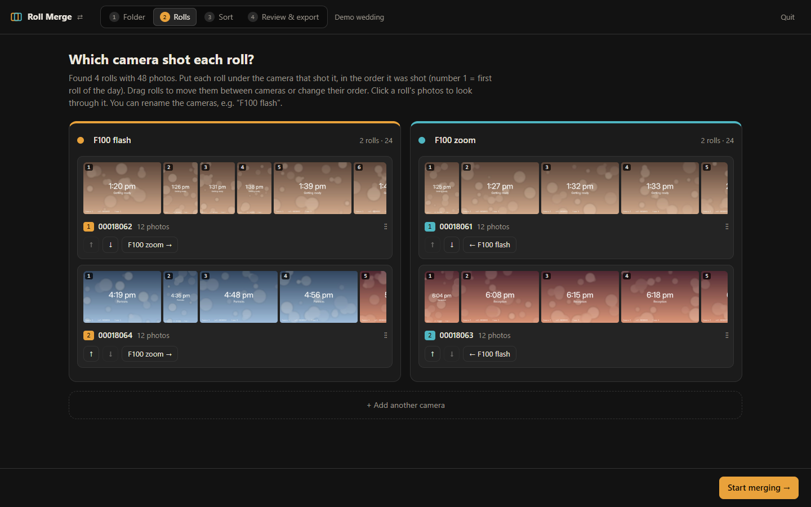
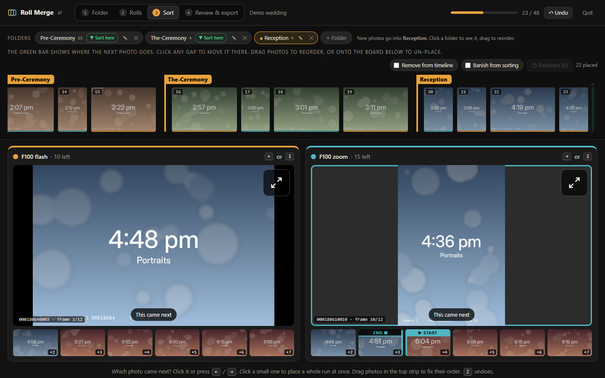
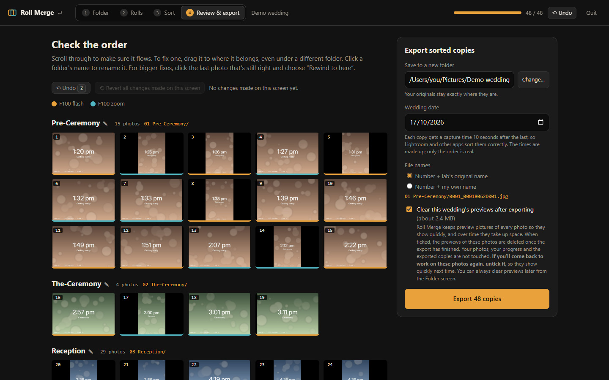

# Roll Sort

**Sort a big folder of photos into folders, quickly, by clicking them.**

Got one folder with a whole shoot in it that needs splitting up, say a product shoot into
*Bracelets*, *Necklaces* and *Earrings*? Roll Sort shows every photo as a big grid. Click a photo
and it goes into the current folder. At the end it saves **copies** into a new folder, one
subfolder per group.

It also comes with **Roll Merge**, for film photographers: it puts scans from two (or more)
cameras back into the order they were shot.

**Your original files are never changed.** Everything runs on your own computer; nothing is
uploaded anywhere.

## Download

Get **`Roll Sort.zip`** from the [latest release](https://github.com/0x-ccsol/Roll-Merge/releases/latest)
and unzip it. Works on **Mac** and **Windows**.

## First time only

1. **Install Python 3** if the computer doesn't have it: <https://www.python.org/downloads/>
   (Windows: tick **"Add python.exe to PATH"** in the installer.)
2. **Mac only:** the first time, macOS may say the Start file "can't be opened".
   Right-click **Start Roll Sort (Mac).command** and choose **Open**, then **Open** again.
   On newer macOS: **System Settings → Privacy & Security** → scroll down → **Open Anyway**.
3. The first start installs a couple of small parts (needs internet, about a minute).

## Start it

Double-click **Start Roll Sort (Mac).command** (or **Start Roll Sort (Windows).bat**). A small
window opens and the app opens in your web browser. Keep that small window open while you work.

The first time, it asks what you'd like to do. Pick **Roll Sort** to sort photos into folders, or
**Roll Merge** for film rolls. It remembers your choice. To switch later, click the name at the
top left.

The two are kept completely separate: each has its own "Pick up where you left off" list,
progress and settings.

## Roll Sort: sorting a shoot into folders

### 1. Choose the folder and add your folders

Choose the folder with the photos, then add a folder for each group with **+ Folder**
(e.g. *Apples*, *Oranges*, *Bananas*).

### 2. Click photos into folders

- **Click** a photo to put it in the current folder (shown in amber). Click **▼ Sort here** on
  another folder to start filling that one instead.
- Sorted photos leave a **blank space**, so nothing jumps around while you click quickly.
  Press **R** (or **Refresh board**) to close up the gaps. It also does this by itself after 12
  gaps, once you stop for a moment. You can change that number, or turn it off.
- **Space** shows the photo under the mouse large. Click outside the photo to close it.
- **Z** undoes. Your progress **saves by itself**, so you can quit and carry on later.
- The strip at the top shows every sorted photo, folder by folder. Drag photos there to move
  them, or drag one back down onto the grid to unsort it.
- **Banish from sorting:** tick it, then click bad shots or duplicates to leave them out.
  Nothing is deleted, and **Banished** lets you get them back.

To do many at once, **Shift-click** the first photo, then **Shift-click** the last one. Everything
in between is selected. Press **Enter** (or **Put all in …**) to put them in the current folder.
**Clear selection** (or **Esc**) starts again.

### 3. Check, then export

The **Review & export** tab shows every folder with its photos. Drag a photo to move it to
another folder, or click a folder's name to rename it. **Undo** and **Revert all changes made on
this screen** fix mistakes.

Then **Export**. Each photo is copied into its folder, keeping its **original name** (or named
*Apples 001*, *Apples 002* …) and its **own date**.

## Roll Merge: film rolls from two cameras

Shooting a wedding on two film cameras? The lab sends the scans back one folder per roll. Each
roll is in order, but nothing says how the two cameras' rolls fit together. Roll Merge shows
the next photo from each camera side by side, and you click whichever one came next.

### 1. Choose the lab's folder and tell it which camera shot each roll

Choose the folder the lab sent (the one with a folder for each roll). Put each roll under the
camera that shot it, in shooting order. Drag rolls between cameras or use the arrow buttons.
Scroll along a roll's photos with the mouse wheel (or the bar under them), and click one to see
it large if you're not sure.

### 2. Click whichever photo came next

- **← / →** (or **1**, **2**) pick camera 1 / camera 2.
- Click a small photo further along to place a **whole run at once**.
- **Z** undoes. Your progress saves by itself.
- **Folders:** click **+ Pre-Ceremony · The-Ceremony · Reception**, then **▼ Sort here** on a
  folder to start filling it.
- The **mouse wheel** scrolls the strip of placed photos at the top. Drag photos in it to fix
  their order.
- **Remove from timeline:** tick it, then click photos in the top strip to send them back down
  to be placed again. Untick it (or press **Esc**) afterwards.
- **Banish from sorting:** tick it, then click bad frames or exact duplicates to leave them out.

### 3. Review, then export

Check the full timeline, drag photos to fix their order, and rename folders. Then **Export**.
The copies are numbered (0001, 0002 …) and get capture times in order, so Lightroom and other
apps sort them correctly. To be safe, sort by **File Name**.

## Try it first

- **Fruit demo** (for Roll Sort): 30 mixed-up photos of apples, oranges and bananas. Add folders
  such as *Apples*, *Oranges* and *Bananas* and sort them. Each photo is labelled, so you can check
  the result.
- **Demo wedding** (for Roll Merge): 4 short practice rolls from 2 cameras. Each photo shows the
  time it was "taken". Camera 1 shot the rolls ending **2** and **4**; camera 2 shot **1** and **3**.

## Good to know

- Works with **JPG** and **TIFF**.
- Roll Sort makes small **preview pictures** so photos show quickly. By default they're cleared
  after a successful export (untick that if you'll come back to the same photos). You can also
  clear them any time from the first screen.
- **Start completely fresh** on the first screen forgets everything Roll Sort (or Roll Merge, or
  both) has saved. Your photos and exported copies are never touched.
- Quit with the **Quit** button in the app, or by closing the small window.
- Needs Python 3.8 or newer. The two extra parts it uses
  ([Pillow](https://python-pillow.org/) and [piexif](https://pypi.org/project/piexif/)) are
  installed automatically on the first start, into a private folder next to the app.
